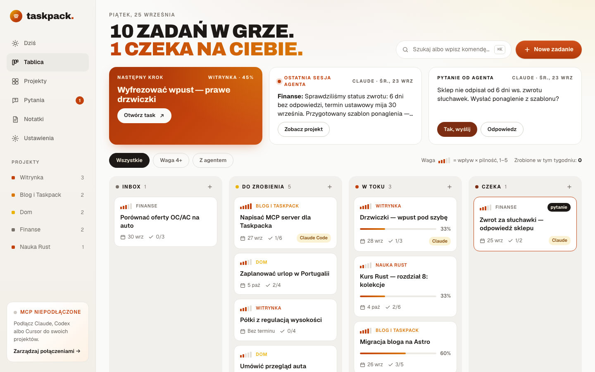
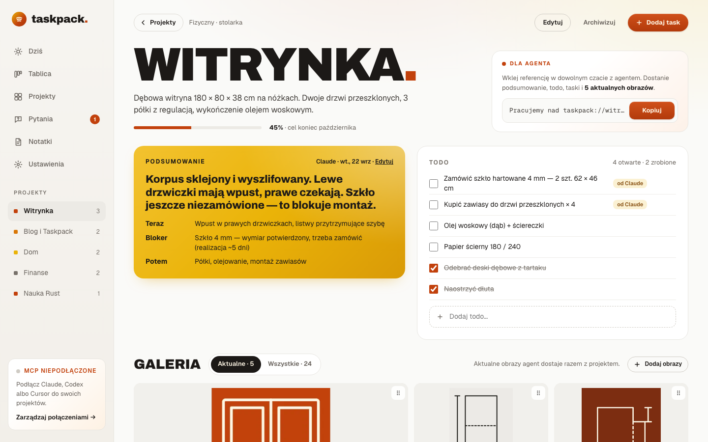
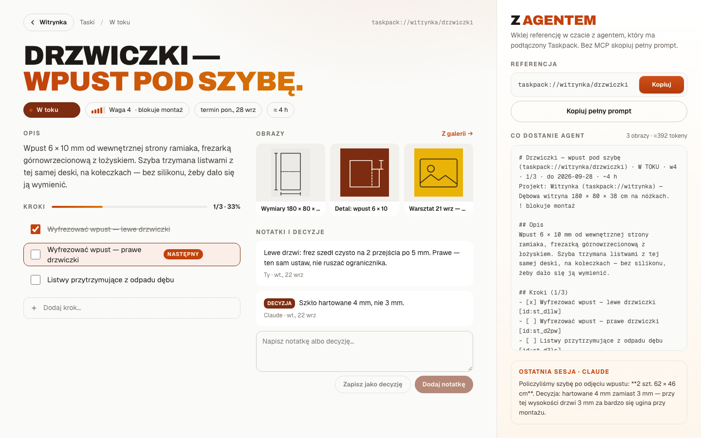
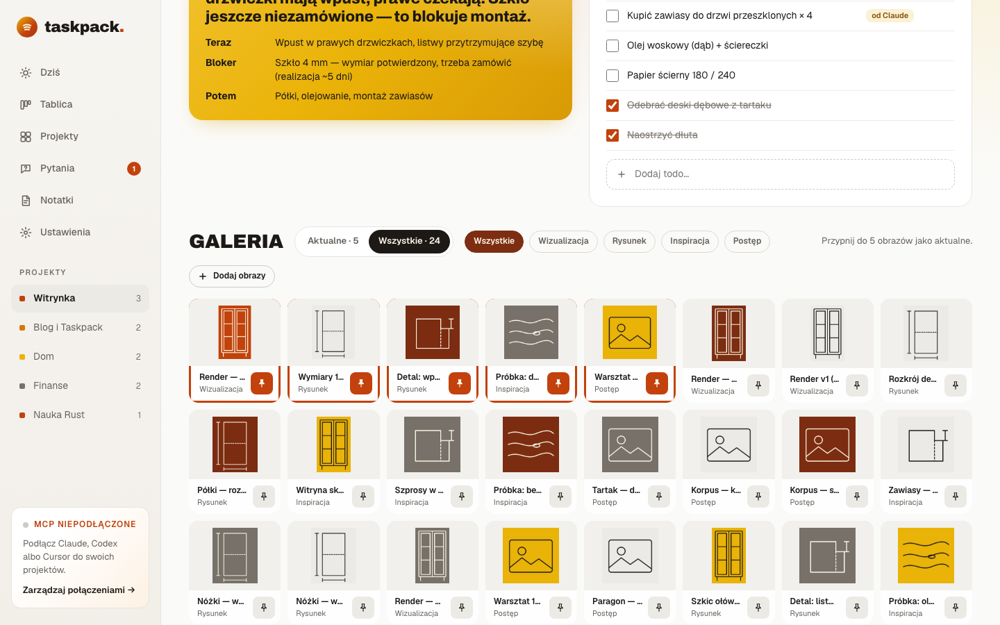
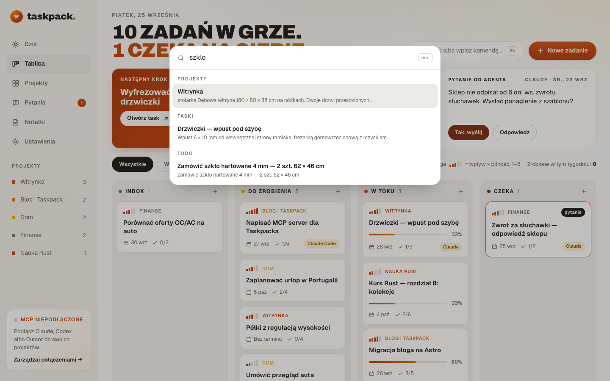

# Taskpack

**Lokalny menedżer projektów i zadań, który Twoi agenci AI potrafią czytać i uzupełniać.**

Projekty, zadania, todo, notatki z sesji i obrazy trzymasz jako zwykłe pliki Markdown/YAML w jednym folderze (`~/Taskpack`). Przeglądasz je w małej lokalnej aplikacji webowej, a Claude Code, Claude Desktop, Codex / ChatGPT desktop i Cursor pracują na tych samych plikach: przez lokalny serwer MCP, CLI `taskpack` albo dostęp do folderu. Wklejasz do czatu `taskpack://<projekt>` i agent dostaje zwięzły kontekst: cel, co zrobione, następny krok, decyzje, ostatnie sesje i aktualne obrazy. Na koniec dopisuje todo, postęp i notatkę z sesji. Każda zmiana jest podpisana i da się ją cofnąć.

English version: [README.md](README.md).



<table>
  <tr>
    <td></td>
    <td></td>
  </tr>
  <tr>
    <td></td>
    <td></td>
  </tr>
</table>

## Dlaczego

- **Dane zostają u Ciebie.** Zwykłe pliki na dysku, czytelne bez Taskpacka, wersjonowane gitem (jeden commit na sesję agenta). Bez konta i chmury; aplikacja słucha tylko na `127.0.0.1`.
- **Agent zaczyna tam, gdzie skończyłeś.** Każdy projekt ma swój kontekst: podsumowanie (teraz / bloker / potem), taski z krokami, decyzje, notatki z poprzednich sesji i do pięciu „aktualnych” obrazów, które agent dostaje za każdym razem.
- **Działa z narzędziami, których już używasz.** Claude Code (skille, komendy, hooki), Claude Desktop (MCP albo rozszerzenie instalowane jednym kliknięciem), Codex / ChatGPT desktop i Cursor (`AGENTS.md` + MCP).
- **Nic nie dzieje się za Twoimi plecami.** Każdy zapis ma autora (`by:claude-code`, `by:user`), sesję agenta cofasz jednym przyciskiem (pod spodem `git revert`), a agenci nie mogą niczego usuwać.
- **Po polsku i po angielsku:** interfejs, pliki i instrukcje dla agentów.

## Funkcje

- **Tablica:** Inbox / Do zrobienia / W toku / Czeka, przeciąganie kart, waga 1–5 (wpływ × pilność), terminy, postęp, oznaczenia „nowe od agenta” i „pytanie”, pasek z następnym krokiem i pytaniami agentów.
- **Projekty:** strona projektu z edytowalnym podsumowaniem, todo, taskami, osią notatek i sesji agentów (z „Cofnij”) oraz galerią podzieloną na *Aktualne* (przypięte, wysyłane agentom) i *Wszystkie*.
- **Taski:** opis, kroki ze znacznikiem „następny”, notatki i decyzje, powiązane obrazy i panel pokazujący dokładnie to, co dostanie agent.
- **Dziś, Notatki, Pytania:** terminy i następne kroki ze wszystkich projektów, strumień notatek i sesji oraz pytania od agentów (odpowiadasz w aplikacji, agent dostaje odpowiedź przy następnej rozmowie).
- **Paleta ⌘K:** wyszukiwanie po wszystkim (bez polskich znaków też: `szklo` znajdzie `szkło`) i szybkie akcje.
- **Na żywo:** gdy agent zmienia workspace (MCP, CLI albo pliki), aplikacja odświeża się w sekundę i pokazuje, kto co zmienił.

## Szybki start

Wymaga Node.js 22+ i pnpm (`corepack enable`).

```sh
git clone https://github.com/wojtek1150/taskpack.git && cd taskpack
pnpm install && pnpm build
pnpm taskpack init --lang pl --example   # tworzy ~/Taskpack z przykładowymi projektami i zestawem dla agentów
pnpm start                               # http://127.0.0.1:4242
```

Bez `--example` zaczynasz od pustego workspace'u. `TASKPACK_HOME=/ścieżka pnpm start` otwiera inny workspace.

## Z agentem

```sh
cd ~/Taskpack && claude                          # Claude Code: skille, komendy /taskpack-*, hooki i MCP są w workspace
pnpm taskpack mcp config claude-desktop --write  # Claude Desktop (także: cursor, codex); pokazuje diff i pyta
pnpm kit:mcpb                                    # albo rozszerzenie Claude Desktop → dist/taskpack.mcpb
```

Potem po prostu rozmawiasz: *„pracujemy nad taskpack://<projekt>, ustal następny krok, dopisz todo i zakończ sesję”*. Agent czyta kontekst, pracuje z Tobą i zapisuje todo, postęp tasków, podsumowanie i notatkę z sesji.

CLI przydaje się w skryptach i każdemu agentowi z dostępem do terminala:

```sh
pnpm taskpack status                              # projekty, następne kroki, otwarte pytania
pnpm taskpack pack taskpack://<projekt>           # kontekst, który dostaje agent
pnpm taskpack --actor claude-code todo add <projekt> "Zamówić części"
pnpm taskpack image add <projekt> ./szkic.jpg --category drawing --pin
```

`tpk` to krótszy alias. Pełny przewodnik (każdy klient, hooki, narzędzia MCP, obrazy, przenoszenie workspace'u): [agent-kit/GUIDE.md](agent-kit/GUIDE.md) (po angielsku, z sekcją po polsku). Wszystkie komendy CLI: [packages/cli/README.md](packages/cli/README.md).

## Jak to działa

```
~/Taskpack/
├─ taskpack.yaml                 ustawienia (język, budżet kontekstu, włączone narzędzia MCP)
├─ AGENTS.md  CLAUDE.md  .claude/  .mcp.json      zestaw dla agentów
├─ inbox.md  questions.md
└─ projects/<projekt>/
   ├─ project.md                 opis + Podsumowanie (Teraz / Bloker / Potem)
   ├─ todos.md                   checklista
   ├─ tasks/<task>.md            status, waga, termin, kroki, notatki, decyzje
   ├─ sessions/<data>-<agent>.md co zrobiła każda sesja agenta
   ├─ notes/
   └─ images/ + images.yaml      podpisy, kategorie, przypięcia, powiązania z taskami
```

Specyfikacja formatu trafia do każdego workspace'u (`.claude/skills/taskpack-workspace/reference/format.md`). `@taskpack/core` zmienia pliki punktowo, nie ruszając innych linii, więc Twoje ręczne edycje i edycje agentów pracujących wprost na plikach zostają.

## Repozytorium

```
apps/server      Express na 127.0.0.1:4242: REST API, aktualizacje na żywo (SSE), serwuje aplikację
apps/web         aplikacja webowa (React 19)
packages/core    format workspace'u, walidacja, operacje odczytu/zapisu, kontekst dla agentów, wyszukiwanie, obrazy
packages/cli     CLI `taskpack` (także hooki Claude Code)
packages/mcp     `taskpack-mcp`, lokalny serwer MCP (stdio)
packages/api     typy wspólne dla serwera i aplikacji
agent-kit/       instrukcje, skille, komendy, subagenci i hooki instalowane w workspace
examples/        przykładowe workspace'y (EN, PL)
e2e/             testy Playwright
```

```sh
pnpm dev         # API na :4242 + Vite na :5173
pnpm test        # Vitest
pnpm test:e2e    # Playwright (raz: `pnpm exec playwright install chromium`)
pnpm lint        # Biome
pnpm typecheck
```

## Licencja

[MIT](LICENSE) © 2026 Wojciech Parys
